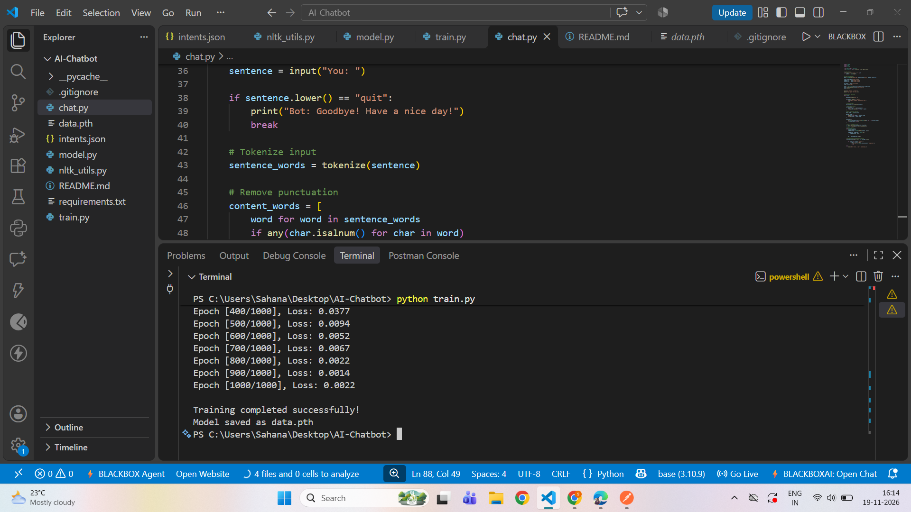

Deep Learning AI Chatbot using PyTorch and NLP

Overview

This project is an AI chatbot developed using Python, PyTorch, and Natural Language Processing (NLP). It is designed to understand user inputs and generate appropriate responses based on predefined intents and a trained neural network model.

Features

* Intent-based text classification
* Natural Language Processing for text preprocessing
* Tokenization and word processing
* Neural network model using PyTorch
* Training and model saving
* Interactive chatbot conversation
* Responses based on predefined intents

Technologies Used

* Python
* PyTorch
* Natural Language Processing (NLP)
* NLTK

Project Structure

* chat.py – Runs the chatbot and handles user interaction.
* train.py – Trains the neural network model.
* model.py – Defines the neural network architecture.
* nltk_utils.py – Contains NLP utilities such as tokenization and text processing.
* intents.json – Stores intents, patterns, and responses.
* data.pth – Saved trained model.
* requirements.txt – Contains project dependencies.

How to Run

1. Clone the repository

git clone https://github.com/snehasu587-lgtm/Deep-Learning-AI-Chatbot-PyTorch-NLP.git

2. Navigate to the project folder

cd Deep-Learning-AI-Chatbot-PyTorch-NLP

3. Install dependencies

pip install -r requirements.txt

4. Train the model

python train.py

5. Start the chatbot

python chat.py

Sample Interaction

AI Chatbot is ready!
Type 'quit' to exit.
You: Hi
Bot: Hey! What can I do for you?
You: Thank you
Bot: Happy to help!
You: bye
Bot: Goodbye! Have a nice day!

Future Improvements

* Add more intents and training patterns
* Improve chatbot accuracy
* Integrate a web-based user interface
* Explore more advanced NLP techniques

Chatbot Demo

Author

Sneha S Umachigi
